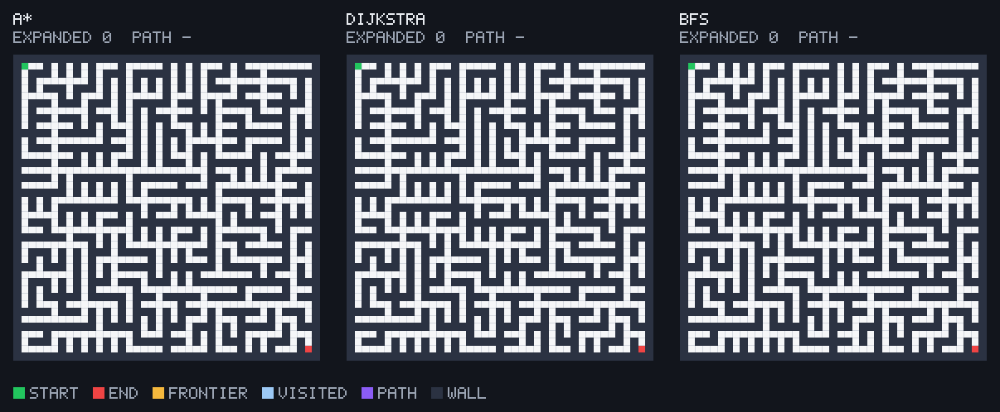

# Pathfinder

[](https://github.com/MSJawad/pathfinder/actions/workflows/ci.yml)

A C++17 program that generates random mazes and races **A\***, **Dijkstra** and
**breadth-first search** through them side by side, counting how much of the
maze each one has to explore before it finds the way out. It draws with SDL2 on
macOS and Linux, and has a headless mode for benchmarking.



*Seed 42, 41x41. All three find the same 80-step path, but A\* expands 326
cells against 789 for the other two.*

## How it works

- **Maze generation** uses randomized Prim's algorithm. Rooms sit on odd
  coordinates and the walls between them are knocked down as the maze grows,
  so the result is a *perfect* maze: every open cell is reachable and there is
  exactly one route between any two rooms. Mazes are deterministic per seed on
  every platform.
- **A\*** orders its frontier by steps taken plus the Manhattan distance to the
  goal. Ties go to the cell closest to the goal, which keeps it heading
  straight for the exit when the way is clear.
- **Dijkstra** orders its frontier by steps taken alone.
- **BFS** uses a plain FIFO queue.

Every move costs the same, so Dijkstra explores cells in the same order as BFS
and expands exactly as many. It is slower only because it pays for a priority
queue that a uniform-cost grid does not need. A\* gets the same shortest path
while expanding about a third as many cells, because the heuristic steers it
away from dead ends that lead away from the goal.

## Results

Averaged over 1000 random 101x101 mazes, from the top-left room to the
bottom-right room:

```sh
./build/pathfinder --headless --size 101 --seed 1 --runs 1000
```

| Algorithm | Cells expanded | Path length | Time per solve |
|-----------|---------------:|------------:|---------------:|
| A\*       |         1378.8 |       224.0 |        0.34 ms |
| Dijkstra  |         4371.8 |       224.0 |        0.93 ms |
| BFS       |         4371.8 |       224.0 |        0.54 ms |

Times come from one run on a busy Apple M1, so expect different absolute
numbers on your machine; the expansion counts and path lengths are the same on
every platform.

## Building

You need a C++17 compiler, CMake 3.20 or newer and SDL 2.0.18 or newer. The
build downloads GoogleTest for the tests.

**macOS** (with [Homebrew](https://brew.sh)):

```sh
brew install cmake sdl2
```

**Debian / Ubuntu:**

```sh
sudo apt install build-essential cmake libsdl2-dev
```

Then, on either:

```sh
cmake -S . -B build
cmake --build build
ctest --test-dir build      # optional: run the tests
./build/pathfinder
```

## Usage

With no arguments, `pathfinder` builds a random 41x41 maze, prints its seed and
the stats for each algorithm, and opens a window that animates all three. Pass
the printed seed back with `--seed` to get the same maze again.

```text
--size N        maze width and height, odd, 5-1001 (default 41)
--start X,Y     start cell (default 1,1)
--end X,Y       end cell (default N-2,N-2)
--algo NAME     astar, dijkstra, bfs or all (default all)
--seed N        maze seed; the same seed gives the same maze (default random)
--delay-ms N    animation delay per expanded node (default 5)
--headless      print stats without opening a window
--runs N        with --headless, average over N seeds starting at --seed
--record DIR    render the animation offscreen to DIR as BMP frames
```

In the window, **Space** pauses, **R** restarts and **Esc** or **Q** quits.
Coordinates start at 0,0 in the top-left corner. Cells with two odd coordinates
are always open, so they are safe choices for `--start` and `--end`.

Some examples:

```sh
./build/pathfinder --seed 42 --algo astar --delay-ms 20   # slow-motion A*
./build/pathfinder --size 81 --start 1,79 --end 79,1      # bigger maze, other corners
./build/pathfinder --headless --seed 7                    # stats only, no window
```

The window always fits the screen. When a maze is too big to give every cell
its own grid-lined square, each panel is drawn as one scaled image instead,
so even `--size 1001` stays on screen and animates smoothly. Big mazes have
hundreds of thousands of cells to expand, so pair them with a small
`--delay-ms` (or `0` to jump straight to the result).

The demo GIF above is made from the program's own frames by
[`scripts/make-demo-gif.sh`](scripts/make-demo-gif.sh), which runs
`pathfinder --record` and needs `ffmpeg`.

## Project layout

| Path | What is in it |
|------|---------------|
| `src/grid.*` | `Point` and the wall/open `Grid` |
| `src/maze.*` | Randomized Prim's maze generator |
| `src/min_heap.h` | Binary min-heap used as the A\* and Dijkstra frontier |
| `src/search.*` | A\*, Dijkstra and BFS as a step-by-step `Search` |
| `src/cli.*` | Command-line parsing |
| `src/renderer.*`, `src/font.*` | SDL2 drawing and a built-in 5x7 bitmap font |
| `tests/` | GoogleTest unit tests |

## History and credits

I first wrote this over the winter of 2019-20 as a single-panel A\* visualizer drawn with raw
Xlib. Its drawing code used the `Xwindow` helper class that the University of
Waterloo's CS 246 course gives to its students. That code has since been
replaced by SDL2 so the program runs natively on macOS, and none of the helper
remains, but the credit stays.

## Contact

*Questions, comments and concerns welcome at solaimanjawad@gmail.com*
